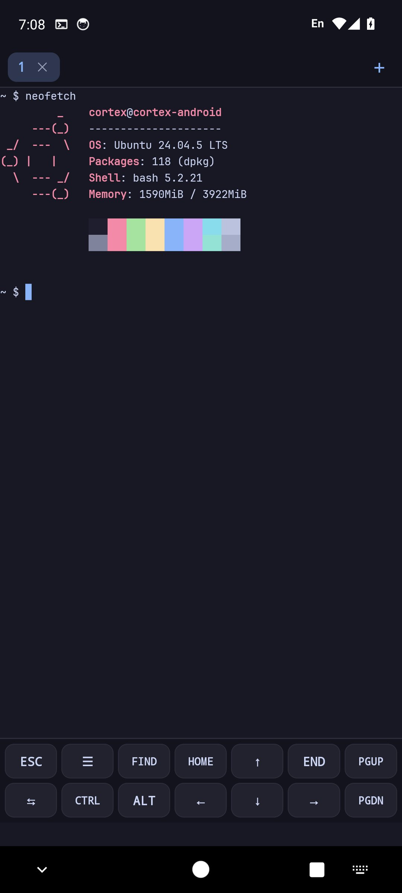
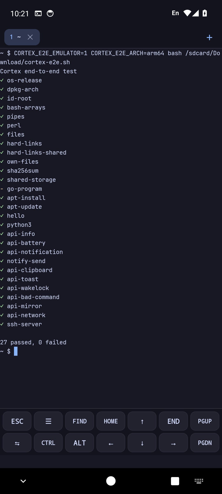
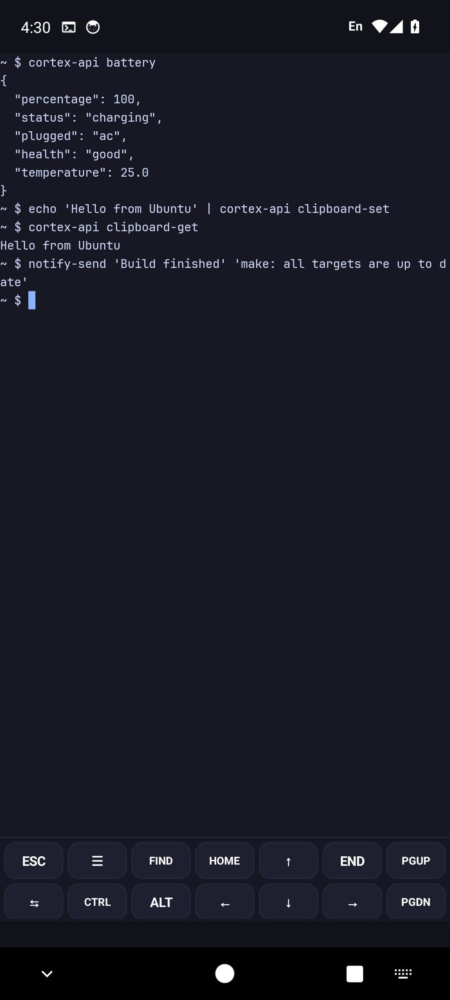
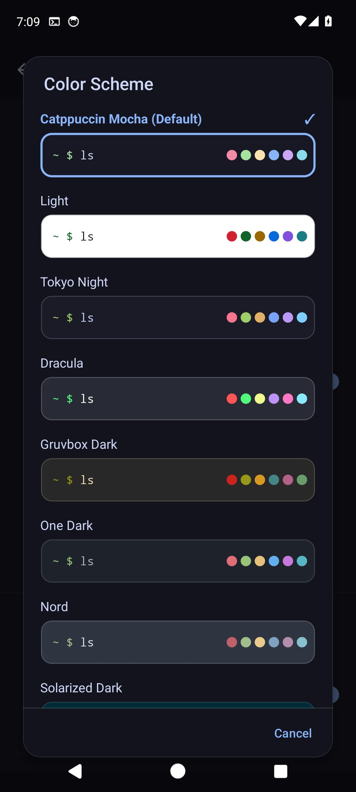
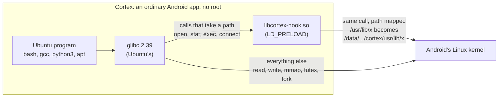

<p align="center">
  
</p>

<h1 align="center">Cortex Terminal</h1>

<p align="center">
  <b>Ubuntu 24.04 on Android, without root, PRoot or a virtual machine.</b><br/>
  Ubuntu's own arm64 programs, installed with <code>apt</code>, running on the phone's CPU and kernel.
</p>

<p align="center">
  <a href="https://github.com/ssfuisu/cortex/releases/latest"></a>
  <a href="https://github.com/ssfuisu/cortex/releases"></a>
  <a href="https://github.com/ssfuisu/cortex/actions/workflows/compat-nightly.yml"></a>
  <a href="LICENSE"></a>
</p>

<p align="center">
  <a href="https://github.com/ssfuisu/cortex/releases/latest"><b>Download</b></a> ·
  <a href="#how-it-actually-works">How it works</a> ·
  <a href="#what-is-real-and-what-is-emulated">Real vs emulated</a> ·
  <a href="https://ssfuisu.github.io/cortex/compat.html">Package tests</a> ·
  <a href="SECURITY.md">Security</a> ·
  <a href="CHANGELOG.md">Changelog</a> ·
  <a href="https://github.com/ssfuisu/cortex/issues">Issues</a> ·
  <a href="https://t.me/ratzgn">Telegram</a>
</p>

<p align="center">
  
  
  
  
</p>

---

## In one paragraph

Cortex is an Android terminal app that ships an Ubuntu 24.04 root file system (built from Ubuntu's official arm64 and armhf images) and runs it inside the app's private storage. The programs are the ones from Ubuntu's archive, not rebuilt for Android. They run as ordinary processes of the app, directly on the CPU, and their system calls go straight to Android's Linux kernel. What makes that work is a library loaded into every program with `LD_PRELOAD`: it maps paths like `/usr` and `/etc` into the app's storage and covers for the things Android does not let an app do. Nothing traces the programs and nothing virtualizes them.

## How it actually works



1. **The library is a function wrapper, not a trap.** `libcortex-hook.so` defines `open`, `stat`, `execve` and about 200 other libc functions. A call goes through it like through any shared library and then to the kernel. There is no `ptrace`, no seccomp trap on the normal path and no second process.
2. **Every program starts through Ubuntu's own loader.** Android has no `/lib/ld-linux-aarch64.so.1`, so `execve` is turned into a start of Ubuntu's `ld.so` from the app's storage, with the library and the right library path.
3. **Android's restrictions are handled one by one.** Android forbids some system calls for apps (seccomp), hard links, System V shared memory and locks on memory files. Each of these has its own code in the library (see the table below).
4. **Static programs are patched, not traced.** A program that makes its own system calls never passes through libc. Before such a program starts for the first time, Cortex patches the forbidden calls in its file (static C and C++) or adds a small piece of code that maps its paths (Go 1.19 and newer, 64-bit).

The library is about 10,000 lines of C in [`app/src/main/cpp/hook`](app/src/main/cpp/hook), with tests that run it under qemu on every change.

### Is this PRoot or fakechroot?

**Not PRoot.** PRoot runs programs under `ptrace` and stops them at the system calls that take a path. Cortex never traces anything.

**Same family as fakechroot, but not fakechroot.** Like fakechroot and fakeroot, Cortex uses an `LD_PRELOAD` library, and that is the honest name for the technique. It does not contain fakechroot or PRoot code. It was written for what Android does differently: the seccomp filter, no exec from writable storage on new target levels, no hard links, no SysV IPC, no other users, and statically linked programs, which fakechroot cannot reach at all.

| | **Cortex** | fakechroot + fakeroot | PRoot (proot-distro) | Linux Terminal app (VM) |
|---|---|---|---|---|
| Technique | `LD_PRELOAD` library | `LD_PRELOAD` library | `ptrace` tracer | Virtual machine |
| A program's system calls | go straight to the kernel | go straight to the kernel | stopped by the tracer when they take a path | go to a guest kernel |
| Static programs | patched before their first start | not covered | covered | covered |
| Android's seccomp, hard links, SysV shm | handled | not handled | partly | not an issue |
| Root needed | No | No | No | No, supported devices only |

"Native" in this README means exactly this: the binaries are Ubuntu's own, they run on the phone's CPU, and the kernel executes their system calls. It does **not** mean Android turned into Ubuntu. The kernel is Android's and the app is still an app, which is what the next section is about.

## What is real and what is emulated

| | In Cortex | Status |
|---|---|---|
| **CPU** | Programs run on it directly, no translation | **Real** |
| **Kernel** | Android's Linux kernel: processes, threads, signals, pipes, sockets, `mmap`, `futex` | **Real** |
| **Programs** | The binaries from Ubuntu's archive, unchanged (glibc and static programs are the exceptions, below) | **Real** |
| **Packages** | `apt` and `dpkg` with Ubuntu's mirrors and signatures | **Real** |
| **Files** | Contents, modes, timestamps, symbolic links | **Real** |
| **Network** | Sockets and DNS, IPv4 and IPv6 | **Real** |
| **glibc** | Ubuntu's 2.39 build with three system call sites patched: `set_robust_list` is skipped, `clone3` and `rseq` answer "not available" so glibc uses the older calls. `libc6` is held at this build | **Adapted** |
| **Paths** | `/` is the app's private directory, mapped in the libc calls | **Emulated** |
| **Root** | Programs see uid 0 and files owned by root, the kernel sees the app's user | **Emulated** |
| **Forbidden calls** | `setuid` and the other calls Android's seccomp filter forbids are answered by a signal handler instead of killing the program | **Emulated** |
| **Hard links** | Copies that report a real link count, the same in every process | **Emulated** |
| **SysV shared memory, memfd locks** | Files of Cortex's own (X11's MIT-SHM, PHP's opcache) | **Emulated** |
| **Static programs** | Patched once in their file before their first start | **Adapted** |
| **Maintenance tools** | A few that package installs call (`systemd-sysusers`, `mandb`, `update-mime-database`) are stand-ins that do nothing | **Adapted** |

**What does not work in normal mode**, because an app is not root: systemd as the init system, real other users (a server that refuses to run as root, such as PostgreSQL's own cluster), ports below 1024, set-user-ID programs, `mount`, kernel modules, reading the kernel's network tables (`ss`, `netstat`), and the GPU. On a rooted phone, [root mode](#root-mode) removes most of these.

## Install

1. Download from [Releases](https://github.com/ssfuisu/cortex/releases/latest): `Cortex-arm64-v8a-signed.apk` for nearly every phone, `Cortex-armeabi-v7a-signed.apk` for 32-bit ARM.
2. Optional: check where it comes from. From 1.27.7 on every APK is built on GitHub from the tagged source, `gh attestation verify Cortex-arm64-v8a-signed.apk --repo ssfuisu/cortex` proves it, and `SHA256SUMS.txt` is next to it. The signing key is in [`signing/README.md`](signing/README.md).
3. Install and open it. Ubuntu is unpacked on the first start, then you get a shell.

Android 7.0 or newer. Like Termux, the app targets API level 28, the last one that lets an app run programs from its own data directory.

```bash
apt install build-essential git python3 nodejs   # the first install fetches the package lists itself
cd /sdcard/Download                              # the phone's shared storage
cortex-desktop install xfce                      # optional desktop, also from the menu
```

## Features

<table>
<tr>
<td width="50%" valign="top">

**Ubuntu**
- `apt` with Ubuntu's archive, signed packages and the fastest mirror picked once
- `build-essential` and `-dev` packages, static linking, OpenJDK, Python, Node.js, Go, Rust
- `sudo` works (you are root as far as programs can tell)
- `cortex-backup` saves `~` and the list of installed packages, `restore` reinstalls them
- Root mode on rooted phones: a real chroot, nothing emulated

</td>
<td width="50%" valign="top">

**Terminal**
- Tabs and sessions that come back after Android ends the app
- Extra keys you can define in `~/.cortex/keys`, pinch to zoom, hardware keyboard shortcuts
- 14 color schemes, true color, CJK and emoji widths, search, clickable links
- OSC 52 clipboard, OSC 133 command notifications, bracketed paste, synchronized output
- 50 interface languages

</td>
</tr>
<tr>
<td valign="top">

**Android**
- `cortex-api`: notifications, clipboard, open and share, battery, vibration, speech
- `notify-send`, `xdg-open` and `termux-clipboard-*` use it
- Home folder visible in Android's Files app
- A notification for local web servers you start (`npm run dev`)

</td>
<td valign="top">

**Desktop and remote**
- X11 desktop (Openbox or XFCE, optional Firefox) shown inside the app, with touch and touchpad modes, shared clipboard and sound
- Drawn by the CPU over a private socket, no network port
- `cortex-sshd`: OpenSSH on port 8022 to use Cortex from a computer

</td>
</tr>
</table>

## Performance

Programs run at native speed. The library only costs something on calls that take a file path and when a program starts. Measured on one 8-core phone (Linux 4.14, one big core, median of 9 runs), time added per call:

| Call | Added by the library |
|---|---|
| `stat()` of a file | +39 ns (+3%) |
| `open` + `read` + `close` | +226 ns (+8%) |
| `opendir` + `readdir` + `closedir` | +426 ns (+7%) |
| `write`, `dup`, `getcwd`, `sigprocmask` | up to +21 ns |
| Code without system calls | 0 |
| Starting a program | 769 µs, against 491 µs for Ubuntu's `ld.so` alone |

Run [`tests/bench/run-micro.sh`](tests/bench/run-micro.sh) inside Cortex to measure your own phone.

**Comparing with proot-distro yourself.** [`tests/bench/compare.sh`](tests/bench/compare.sh) runs the same tests anywhere (starting programs, creating, listing and reading files, `tar`, `find`, pure CPU, Python start-up, a compile, `apt-cache`) and prints a table. Run it in Cortex and in proot-distro on the same phone:

```bash
curl -fsSL https://raw.githubusercontent.com/ssfuisu/cortex/main/tests/bench/compare.sh | bash
```

It also says what it detected it runs in, so the two tables can't get mixed up.

## Root mode

On a rooted phone (Magisk, KernelSU, APatch), *Settings > Root mode* runs new sessions as real root in a chroot of the same Ubuntu files. The library is not loaded there. Mounts, real owners, hard links, set-user-ID programs and low ports work as on a PC. Each session gets its own mount namespace, so nothing is mounted for Android or other apps. Turning it off gives the files back to the app.

Containers need root mode. Since 1.27.7 it also mounts the phone's cgroups at `/sys/fs/cgroup`, and [docs/containers.md](docs/containers.md) has the steps for Podman and Docker, including the iptables setting many Android kernels need.

## Is it safe for the phone?

In normal mode Cortex is an ordinary app: everything you run in it runs as the app's own Android user, in the app sandbox. It can't change Android, the system or other apps' private data, it can't brick anything, and uninstalling removes everything in the app's own storage. Programs only *think* they are root. The one thing to keep in mind: once you allow storage access, commands can change and delete your files in `/sdcard`, and uninstalling doesn't undo that. [SECURITY.md](SECURITY.md) explains every permission the app asks for and what the app itself connects to (Ubuntu's mirrors and GitHub's release API, nothing else).

## FAQ

**What do people actually use it for?**
Programming on the phone or tablet (Python, Node.js, C, Rust, Go, git), small servers and bots (nginx, Redis, MariaDB, a Telegram bot), SSH into Cortex from a computer with `cortex-sshd`, scripts that use the phone through `cortex-api`, and the occasional desktop program on the built-in X11 desktop.

**Will every Ubuntu package work?**
Most command-line software does. Every night a job installs a set of common packages on an emulator and tests each one, the [latest results](https://ssfuisu.github.io/cortex/compat.html) are public, failures included. What needs the things in the list above (systemd services, other users, raw devices) does not work in normal mode.

**Can I run Docker or Podman?**
Only in root mode, see [docs/containers.md](docs/containers.md). Containers need namespaces, mounts and cgroups, and Android never gives those to an app.

**Is there a GUI?**
Yes, as an add-on: *Desktop* in the menu installs Openbox or XFCE (and Firefox if you want) and shows it inside the app. It's drawn by the CPU, no GPU, so it suits editors and browsing more than games.

**Does it work on 32-bit phones?**
Yes, `Cortex-armeabi-v7a-signed.apk` is Ubuntu's armhf. Every change builds it and installs and sets it up on an emulator, but the emulator can't run 32-bit Ubuntu programs, so the in-terminal tests only run for 64-bit. Reports from 32-bit phones help.

**Why does Go need special code?**
Go programs don't use the C library, they make their system calls themselves, so a preloaded library never sees them. Before a Go 1.19+ program starts for the first time, Cortex adds a small piece of code to it that does the same path mapping.

**Do single-file downloads work?**
Static C and C++ programs do, and Go programs built with Go 1.19 or newer. Older or 32-bit Go programs run but see Android's files instead of Ubuntu's.

**Why does `pip install` refuse?**
That is Ubuntu 24.04's own rule (PEP 668). Use `python3 -m venv`, `pipx` or `apt install python3-<name>`.

**Where are my phone's files?**
At `/sdcard`, after you allow storage access.

**How do I report a problem?**
*Settings > Send a bug report* writes a text file with the versions and logs. Attach it to an [issue](https://github.com/ssfuisu/cortex/issues) or send it on [Telegram](https://t.me/ratzgn).

---

<p align="center">
  Apache License 2.0 · Developed in spare time, so answers can take a few days
</p>
