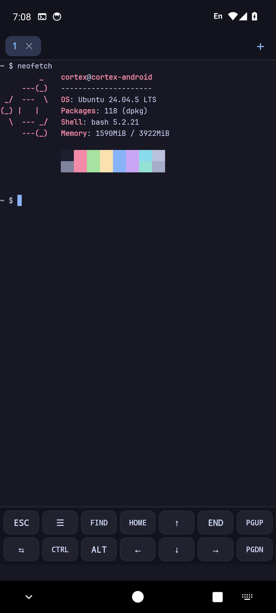
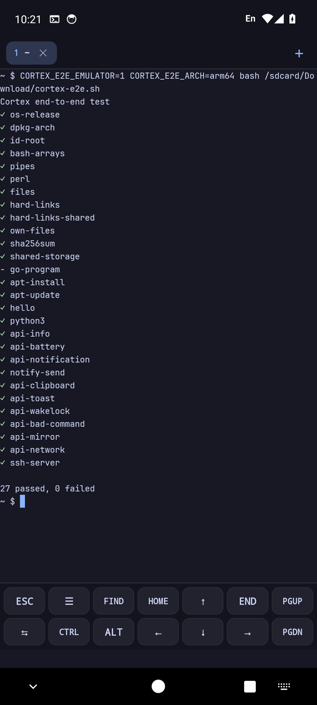
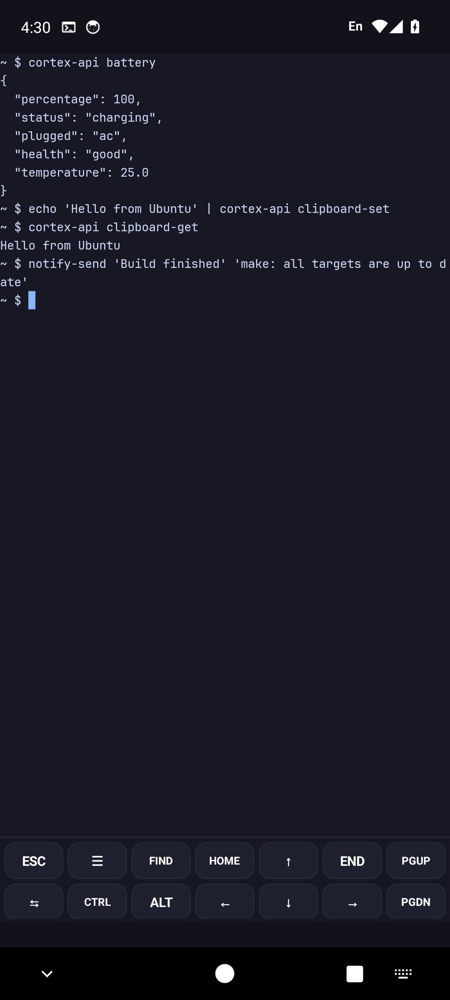
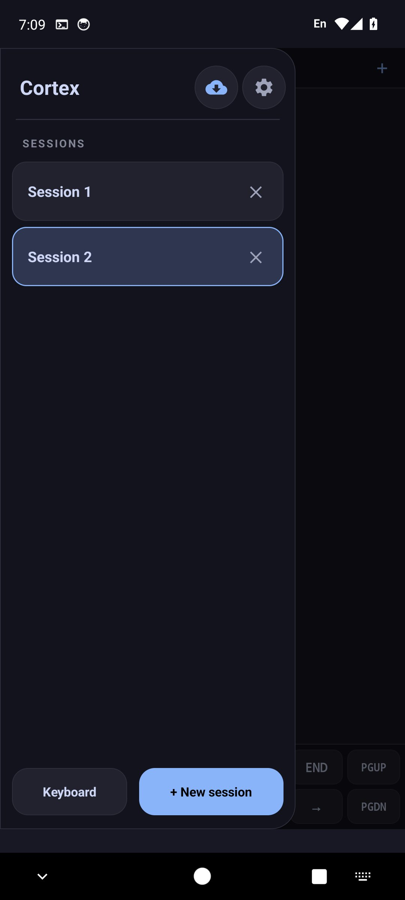
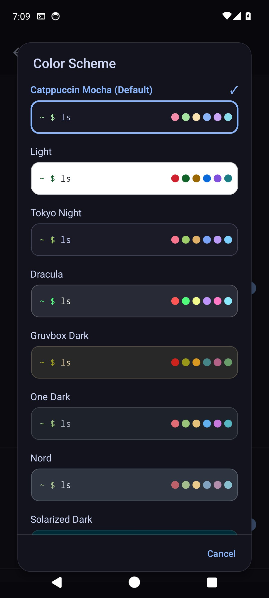
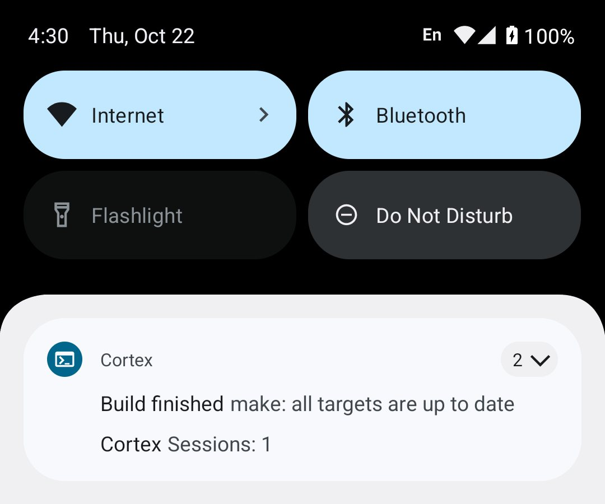
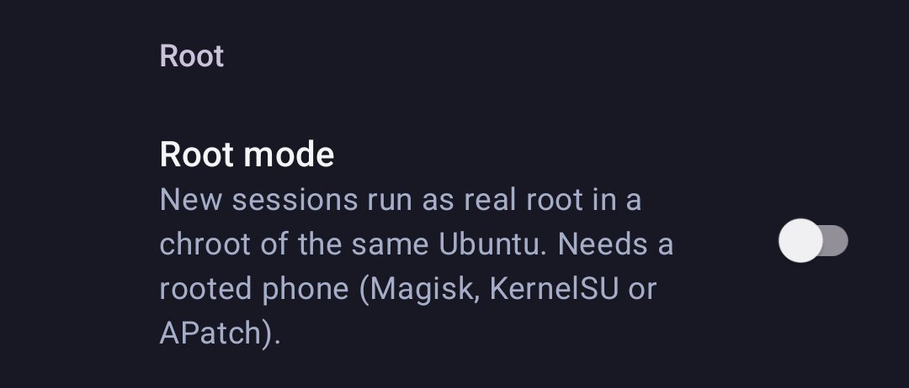

# Cortex Terminal: Ubuntu 24.04 on Android, natively

**Run real Ubuntu 24.04 LTS (glibc 2.39, `apt`) directly on your Android phone or tablet: no root, no PRoot, no containers, no virtual machine.**
Cortex is a free and open-source terminal app and a native alternative to Termux + proot-distro for people who want genuine Ubuntu packages on Android (arm64 and armv7).

[](https://github.com/ssfuisu/cortex/releases/latest)
[](https://github.com/ssfuisu/cortex/releases)
[](https://github.com/ssfuisu/cortex/stargazers)
[](https://t.me/ratzgn)
[](LICENSE)
[](https://github.com/ssfuisu/cortex/actions/workflows/compat-nightly.yml)

**[Download the latest APK](https://github.com/ssfuisu/cortex/releases/latest)** · [Website](https://ssfuisu.github.io/cortex/) · [Changelog](CHANGELOG.md) · [Report a bug](https://github.com/ssfuisu/cortex/issues) · [Telegram](https://t.me/ratzgn)

<p align="center">
  
  
  
</p>

<p align="center">
  
  
</p>

## What is Cortex?

Cortex is a next-generation native Linux terminal and development powerhouse engineered for Android.  
It delivers an authentic **Ubuntu 24.04 LTS (Noble Numbat)** environment powered by **GNU C Library (Glibc 2.39)** on unrooted devices.  
Unlike existing solutions, Cortex operates with **ZERO virtualization, ZERO PRoot, and ZERO containers**.  
All command-line utilities, compilers, and runtimes execute directly on your physical CPU cores and the Android Linux kernel.  
With full APT package management, high-speed developer launchers, and a modern Material 3 interface, Cortex turns your Android device into a complete coding workstation.

---

## Why Cortex?

| | **Cortex** | Termux (its own packages) | Termux + proot-distro | Android Linux Terminal (VM) |
|---|---|---|---|---|
| Needs root | No | No | No | No |
| How Linux programs run | Directly on the Android kernel; a small `LD_PRELOAD` library maps `/usr`, `/etc`, ... into the app's private storage | Directly, as programs built for Android | Inside PRoot, a user-space chroot that intercepts system calls with `ptrace` | Inside a virtual machine (Android Virtualization Framework, supported devices only) |
| C library | glibc 2.39 (Ubuntu) | Bionic (Android's libc) | glibc of the chosen distribution | glibc (Debian) |
| Package source | Ubuntu 24.04 archive via `apt` | Termux repositories via `pkg` | The distribution's own `apt` | Debian `apt` |
| Cost of running programs | No `ptrace`. The library adds 0.04 to 0.4 µs to most file-path calls (1.3 µs to `lstat()` of a symbolic link) and about 0.3 ms to starting a program ([details](#performance)) | None | `ptrace` stops on every system call | Virtualization overhead |

Pick Cortex when you need Ubuntu's own `.deb` packages and a genuine glibc without the layers PRoot or a VM add. Termux remains a great choice for its large, Android-specific package set.

---

## Features

- **Genuine Ubuntu 24.04 LTS & Glibc 2.39**: Run standard GNU/Linux software, compilers, and modern libraries without Android Bionic libc limitations or missing header errors.
- **Native Execution**: No PRoot `ptrace` system call traps, no chroot (except in the optional [root mode](#root-mode)), and no QEMU/KVM emulation. Code runs on the phone's CPU at full speed; the small preloaded library adds a few percent to calls that take a file path (see [Performance](#performance)).
- **Full Debian/Ubuntu APT Package Manager**: Complete, zero-warning package installation (`apt update`, `apt install`) verified with official Ubuntu archive GPG keyrings and dynamic DNS.
- **Full OpenJDK 17 JDK & JRE Runtime**: Out-of-the-box Java 17 development support (`apt install openjdk-17-jdk`) with dynamic linker library path preservation and POSIX shared memory (`/dev/shm`).
- **High-Speed AI & Developer Launchers**: One-command instant CDN setups for OpenCode, Meta Muse Code, and Google Antigravity.
- **Bun & Node.js Crash Prevention**: Transparent `inotify_add_watch` auto-provisioning ensures Bun-based tools like OpenCode never crash due to missing configuration directories.
- **Modern Material 3 Terminal Interface**: Sleek dark UI, high-framerate font rendering, full 256-color & 24-bit TrueColor support, and JetBrains Mono monospace typography.
- **Virtual Keyboard Toolbar of Your Own**: Quick-access keys for `ESC`, `TAB`, `CTRL`, `ALT` and the arrows; `~/.cortex/keys` sets up to 4 rows of your own keys, `F1`-`F12`, symbols and text such as `git status` (see [Your Own Keys](#your-own-keys)). Two fingers change the text size.
- **Sessions That Come Back**: When Android ends Cortex, its sessions are there again at the next start, in their folders and with the end of their output.
- **Integrated Terminal Search**: Swipe across the keyboard toolbar or tap `FIND` to search through 5,000 lines of scrollback buffer with real-time match counts and navigation.
- **Clickable Links & Clipboard Image Insertion**: Underlined URLs and OSC 8 hyperlinks are copied to the clipboard when tapped; tapping images in your keyboard clipboard automatically saves and types their file path.
- **Multi-Session Management**: Seamlessly spawn, switch between, and manage multiple active terminal sessions from the tabs above the terminal (each named after its directory) or the left navigation drawer.
- **Fourteen color schemes, one look**: Catppuccin, a white one (Light), Tokyo Night, Dracula, Gruvbox, One Dark, Nord, Solarized, Monokai, Rosé Pine, Everforest, GitHub Dark, Ayu Mirage and a pure black one for OLED screens. The keys, tabs, drawer, settings and system bars take their colors from the scheme, so the whole screen changes with it.
- **Full Storage & Background Services**: Deep `/sdcard` device storage integration and standard background service controls via `service`, `/etc/init.d/`, and `/etc/cortex/autostart`.
- **SSH Server and Local Web Servers**: `cortex-sshd` (or Settings > Remote access) starts Ubuntu's OpenSSH on port 8022 to use Cortex from a computer, and a notification opens the web servers programs start (`npm run dev`, `python3 -m http.server`) in the browser (see [Remote Access](#remote-access)).
- **Android Integration**: `cortex-api` for notifications, the clipboard, opening links and files in Android apps, sharing, battery state, speech and vibration; `notify-send` and `xdg-open` use it (see [Android Integration](#android-integration-cortex-api)).
- **Root Mode**: On a rooted phone, sessions can run as real root in a chroot of the same Ubuntu files, with nothing translated or emulated (see [Root Mode](#root-mode)).

---

## How It Works

```
+-----------------------------------------------------------+
|                      Cortex Terminal                      |
|                                                           |
|  +-----------------------------------------------------+  |
|  | Modern Material 3 UI (Sessions, Search, Keys Bar)   |  |
|  +-----------------------------------------------------+  |
|                            |                              |
|  +-----------------------------------------------------+  |
|  | Native PTY Controller (Direct Unix Terminal Bridge) |  |
|  +-----------------------------------------------------+  |
|                            |                              |
|  +-----------------------------------------------------+  |
|  | Userspace Hook (libcortex-hook.so, no ptrace)       |  |
|  +-----------------------------------------------------+  |
|                            |                              |
|  +-----------------------------------------------------+  |
|  | Android Linux Kernel (Direct Hardware CPU Execution)|  |
|  +-----------------------------------------------------+  |
+-----------------------------------------------------------+
```

1. **Direct Kernel Execution**: Cortex does not run inside a virtual machine or container. Programs execute directly on your device's real ARM64 / ARMv7 hardware threads using Android's native Linux kernel.
2. **Userspace Redirection (`libcortex-hook.so`)**: Using an ultra-lightweight dynamic linker hook injected via `LD_PRELOAD`, standard Linux filesystem paths (`/usr`, `/bin`, `/etc`, `/tmp`) are transparently redirected to Cortex's private application space without slow operating system-level traps.
3. **No Root Required**: All path mapping, permission polyfills, and simulated root privileges (`getuid` / `geteuid`) happen strictly in userspace, allowing full development capabilities on any unrooted Android device.


---

## Performance

Cortex runs programs directly on the phone's CPU, so work that does not call the kernel (compilers, interpreters, compression, your own code) runs at native speed. The preloaded library `libcortex-hook.so` adds a small cost in two places: on calls that take a file path, because the path has to be mapped into Cortex's storage, and when a program is started.

Measured on one 8-core Android phone (Linux 4.14, one big core, median of 9 interleaved runs). "Added" is the time the library adds to one call, compared with the same call on a real path without the library:

| Call | Cortex 1.26.29 | this release |
|---|---|---|
| `stat()` of a file | +260 ns (+18%) | **+39 ns (+3%)** |
| `open` + `read` + `close` | +277 ns (+10%) | **+226 ns (+8%)** |
| `fopen` + `fclose` | +390 ns (+12%) | **+82 ns (+2%)** |
| `readlink()` | +269 ns (+22%) | **+179 ns (+14%)** |
| `opendir` + `readdir` + `closedir` | +600 ns (+10%) | **+426 ns (+7%)** |
| `stat()` of a command that is not in `/usr/bin` (what a shell does when it searches `PATH`) | +1,867 ns (+141%) | **+107 ns (+8%)** |
| `lstat()` of a symbolic link | +1,526 ns (+113%) | +1,306 ns (+97%) |
| `write()`, `dup()` + `close()`, `getcwd()`, `sigprocmask()` | up to +21 ns | up to +21 ns |
| Computation without system calls | 0 | 0 |

`lstat()` of a symbolic link stays expensive because the library reads the link to report its size the way Ubuntu does.

**Starting a program** (what a shell does for every command): the library made 19 system calls before the program started and now makes 7, no longer changes the permissions of `ld.so` each time, and lists the library directories that hold nearly every library first, so a program no longer pays two failed lookups per library (`apt-cache` made 34 of them, `bash` 4, now none). Starting a program through the library takes 769 µs instead of 903 µs; starting `ld.so` by hand without the library takes 491 µs.

**Starting a program in 1.26.40**: measured against the previous release on one x86 Linux machine with the same benchmark (`tests/bench/run-micro.sh`, 25 interleaved runs each): what the library adds to starting `ld.so` with a program fell from 457 µs to 189 µs, and starting a program the way a shell does is 16% faster (1,253 µs to 1,053 µs; a script 11%). The library no longer looks into `/proc/self/fd` in every program (the first program of a session looks; those it starts are told by `CORTEX_NT=0` that there is nothing to find, as on any phone that runs ARM code itself), no longer repeats the library directories in the `--library-path` it gives `ld.so` (which went through each of them twice), and compares only the names that begin with the same letter when it prepares the environment (this was 81,000 instructions before every start, now 17,000). Counted with qemu-user, a program that does nothing makes 177 system calls instead of 236 (170 without the library), a shell that starts a program five times 548 instead of 916, a login shell 1,111 instead of 1,357, `dpkg -l` 569 instead of 752. These figures come from an x86 machine and from qemu-user; a phone has not been measured, and shows other times.

**Whole commands** (`find`, `ls -lR`, `dpkg`, `tar`, `grep -r`, compiling a C file, reinstalling 36 packages) differ from the previous version by less than the up to ±10% variation of the phone from run to run, with two exceptions that held in two separately designed measurements: `ls -lR` is about 20% faster (it no longer prints an error line for every symbolic link) and a shell that starts a program a hundred times is 5 to 14% faster. The library was a small part of the other commands to begin with. Numbers differ from phone to phone, so compare builds on the same device.

To measure your own device (inside Cortex, with a C compiler installed):

```bash
tests/bench/run-micro.sh                      # the installed library against no library
tests/bench/run-micro.sh old=/tmp/hook-old.so new=$CORTEX_ROOT/usr/lib/libcortex-hook.so
```

---

## Shell Environment (Ubuntu 24.04 compatible)

Cortex starts a standard **bash login shell** and follows Ubuntu's startup order, so installers behave as they do on a real Ubuntu machine:

| File | Owner | Purpose |
|------|-------|---------|
| `/etc/profile`, `/etc/bash.bashrc` | Ubuntu | stock system-wide startup |
| `/etc/profile.d/00-env.sh`, `01cortex.sh`, `02-cortex-shell.sh` | Cortex (rewritten on every app start) | `CORTEX_ROOT`, `LD_PRELOAD`, de-duplicated `PATH`, APT/CA/timezone settings, `reload` |
| `~/.profile`, `~/.bashrc` | **You** | created once from `/etc/skel`; Cortex never rewrites them again |

- `SHELL=/bin/bash` is exported, so installers such as `nvm`, `bun`, `rustup`, `pnpm` and `opencode` append their `PATH` setup to `~/.bashrc` exactly like on Ubuntu.
- **Automatic reload:** when an installer (or you) changes `~/.bashrc`, `~/.profile` or `~/.bash_profile`, the running shell re-sources it at the next prompt, so `nvm`, `opencode` and friends work immediately without restarting the terminal. Run `reload` to do it by hand, or `export CORTEX_AUTO_RELOAD=0` (e.g. in `~/.bashrc`) to disable it.
- Cortex keeps its compact `\w $` prompt via one line at the end of a new `~/.bashrc`; delete that line to get Ubuntu's `user@host:dir$` prompt.

---

## Terminal Integration

Programs talk to the Android side through standard terminal escape sequences, so there are no extra sockets, services or permissions to set up:

- **Clipboard (OSC 52):** `tmux` (`set -g set-clipboard on`), `vim`/`neovim` clipboard providers and `ssh` sessions can copy text to the Android clipboard. Only writing is supported; programs can never read your clipboard. Switch it off under *Settings > Notifications & Clipboard*.
- **Long command notifications (OSC 133):** the shell reports when each command starts and ends. If a command that ran longer than the limit (15 s / 30 s / 1 min / 5 min, default 30 s) finishes while Cortex is in the background, you get a notification with the exit status. Inside `tmux` the marks are swallowed by `tmux` itself. Opt out in the shell with `export CORTEX_COMMAND_MARKS=0`.
- **Hyperlinks (OSC 8):** output such as `ls --hyperlink=auto` or `gcc` diagnostics is underlined and tapping it copies the target. Plain `https://` text is detected as before.
- **Bracketed paste (mode 2004):** programs that ask for it (bash, zsh, fish, vim, neovim) are told that text was pasted, so a multi-line paste keeps its lines and nothing runs until you press Enter. Control characters in the pasted text are removed. Other programs get the paste joined into one line, as before.
- **Cursor shape (DECSCUSR):** programs can switch between a block, underline or bar cursor, steady or blinking, such as neovim's bar cursor in insert mode.
- **Focus events (mode 1004):** `tmux` (`set -g focus-events on`), vim and neovim are told when Cortex goes to the background or another session is shown, which `autoread` and similar features use.
- **Synchronized output (mode 2026):** programs that announce their frames, such as neovim 0.10 and newer, are only shown complete frames, so full-screen redraws no longer flicker.
- **Copy and paste:** long-press the terminal to select a word (drag the handles to change the selection), then *Copy*, *Paste* or *Select all* in the bar above it (under it on the first rows). Holding the keyboard's backspace keeps deleting, as in any text field.
- **Chinese, Japanese, Korean and emoji:** these characters take two cells, as they do for bash, `ls`, `vim` and the other programs that count columns with `wcwidth()`, so they no longer overlap the next character and the cursor stays where the program expects it. Invisible characters (zero-width spaces, variation selectors) take none. Copy, search and links count them right; a keyboard that composes a word first (the pinyin of a Chinese word, Japanese kana) has it replaced by what is committed.
- **Rewrapping:** when the phone is turned or the font size changes, long lines in the scrollback and on the screen are rewrapped for the new width instead of staying broken or cut off.
- **Text size with two fingers:** spreading or pinching them on the terminal changes the text size (6 to 36), which Cortex keeps.
- **Sessions that come back:** when Android ends Cortex (to free memory, or for an update of the app), its sessions are there again at the next start: as many as there were, the one that was shown, each in its folder and with the end of its output, dimmed. The programs that ran in them have stopped and start anew. Leaving Cortex with *Exit* closes them for good; *Settings > Sessions* turns it off.

> The prompt hooks are added to `PROMPT_COMMAND` at login. If your `~/.bashrc` *replaces* `PROMPT_COMMAND` instead of appending to it (`PROMPT_COMMAND="...;$PROMPT_COMMAND"`), automatic reload and the marks are lost.

## Backup and Restore

```
cortex-backup                  # saves ~/ and /root to /sdcard/Download/cortex-backup-<date>.tar.gz
cortex-backup restore FILE     # puts them back and installs the missing packages (asks first; --yes skips the questions)
cortex-backup packages         # installs the packages of the restored backup later
cortex-backup list             # shows existing backups
```

Caches (`~/.cache`, `~/.npm/_cacache`) and a `~/storage` link (if you made one) are skipped (`--include-caches` keeps them). Archives that contain anything outside `home/` and `root/` are refused. The installed programs themselves are not part of a backup, but the list of the packages installed with `apt` is, with the apt sources and keys of other vendors (such as NodeSource): `restore` puts the sources back and installs the packages that are missing, after asking (`--no-packages` leaves them out). A package that is gone from the archive does not stop the others.

## Files App Integration

The Cortex home directory shows up as **Cortex** in Android's *Files* app and in every file picker, so you can open, share, create, rename and delete files without copying them to shared storage first. Only the home directory is exposed (never the Ubuntu system tree), links that point outside it (such as a `~/storage` you made) stay hidden, and other apps can only reach files you pick yourself. Turn it off under *Settings > Files*.

## Android Integration (`cortex-api`)

Programs in the terminal can use Android features through `cortex-api`, in normal and in root mode:

```
cortex-api notification -t "Build" -c "finished in 3 min"   # also: make && notify-send "Build done"
cortex-api clipboard-set "text"     # or: some-command | cortex-api clipboard-set
cortex-api clipboard-get
cortex-api open https://example.com # xdg-open uses it too, so links and files open in Android apps
cortex-api open report.pdf          # a file in Cortex or in shared storage
cortex-api share -f photo.jpg       # or share text: echo hi | cortex-api share
cortex-api battery                  # JSON: percentage, status, plugged, health, temperature
cortex-api toast "hello"
cortex-api tts "hello"
cortex-api vibrate -d 500
cortex-api wakelock on              # also: wakelock off, wakelock status
cortex-api mirror show              # the Ubuntu mirror apt uses; also: mirror auto, mirror official
cortex-api network                  # the phone's addresses, Wi-Fi first (ip and ifconfig cannot ask Android)
cortex-api info
cortex-api --help
```

<p align="center">
  
</p>

`notify-send` shows its notifications on Android through it, and `xdg-open` (with `open`, `termux-open` and the browser names) opens links and files in Android apps. `termux-clipboard-set` and `termux-clipboard-get` are the clipboard by the names editors look for, so Neovim's `"+y` and `"+p` (and Helix's `space y` and `space p`) use Android's clipboard. The app listens on `127.0.0.1` while it runs; the port and a secret token are in `/run/cortex-api`, which only Cortex itself and root can read, so other apps cannot use it. Android lets an app open other apps only while it is on screen, and from Android 10 on also read the clipboard only then, so those commands report an error while Cortex is in the background.

## Remote Access

**SSH.** Settings > Remote access > *Start the SSH server* (or the command `cortex-sshd`) installs Ubuntu's OpenSSH the first time, starts it on port 8022 (ports below 1024 need root on Android) and shows how to connect:

```
cortex-sshd                          # start; shows "ssh -p 8022 root@192.168.1.23" and who can log in
cortex-sshd key 'ssh-ed25519 AAAA... you@computer'   # let a computer's key in (or: passwd)
cortex-sshd enable                   # start it with Cortex from now on (disable: no longer)
cortex-sshd status | stop | restart [-p PORT]
```

The server runs while Cortex runs; `cortex-api wakelock on` keeps it going with the screen off. Its settings are in `/etc/ssh/sshd_config.d/cortex.conf`, its log in `~/.cortex/sshd.log`.

**Local web servers.** When a program in Cortex serves web pages (`npm run dev`, `python3 -m http.server`, `jupyter lab`, `hugo server`...), a notification offers to open it in the browser or to copy its address, and goes away when the server stops. Only servers that answer HTTP count, so SSH, databases and the like stay quiet. Settings > Notifications & Clipboard > *Local web servers* turns it off.

## Your Own Keys

The keys above the keyboard come from `~/.cortex/keys` when it exists; Cortex uses it as soon as it is saved. `~/.cortex/keys.example` has the keys as they are now and explains the format:

```
# one row per line (up to 4), keys separated by spaces (up to 12 a row)
ESC MENU FIND HOME UP END PGUP
TAB CTRL ALT LEFT DOWN RIGHT PGDN
| ~ / - gs="git status\n" F5 PASTE KEYBOARD
```

A key is a name (`ESC TAB CTRL ALT UP DOWN LEFT RIGHT HOME END PGUP PGDN INS DEL BKSP ENTER SPACE F1`...`F12`, `MENU` for the sessions, `FIND`, `PASTE`, `KEYBOARD`), one or more symbols (`|`, `~`, `::`), text in quotes (`"\e:wq\n"`: `\n` is Enter, `\e` Escape), or `LABEL=KEY` for another label on the button. `CTRL` and `ALT` also work with the symbols (`CTRL` then `c` is Ctrl+C) and with the arrow keys (`CTRL` then `←` moves by a word). A file Cortex cannot use is reported with its line, and the default keys are shown.

## Root Mode

<p align="center">
  
</p>

On a rooted phone (Magisk, KernelSU or APatch), *Settings > Root mode* runs new sessions as real root in a chroot of the same Ubuntu files that normal sessions use. Before switching, Cortex checks that `su` gives root and that the chroot can be set up. The setting stays on across restarts until you turn it off, and sessions that run as root are marked **ROOT** in the session list.

In root mode nothing is translated or emulated: the preloaded library is not used, and programs see the kernel as root does. `mount`, real `chown` and file owners, hard links, set-user-ID programs (`sudo`, `passwd` and `ping` for other users; Android mounts its data partition without them, so each root session remounts the rootfs for itself), services that switch users and ports below 1024 work as on a Linux PC. Each root session gets its own mount namespace with `/proc`, `/sys`, `/dev`, `/dev/pts` and `/sdcard` (and `/dev/shm` shared with normal mode); these mounts exist only inside the session and go away with it, so nothing is mounted for Android or other apps. `su` is Ubuntu's own `su` there, and `sudo` runs the command directly (`sudo -u USER` through `runuser`). The home directory is the same as in normal mode.

Turning root mode off closes the root sessions and gives the files they created back to the app (owner and SELinux label), because normal sessions run as the app and could not change files owned by root. Owners set inside root mode, for example a database directory owned by `postgres`, are replaced then; set them again after switching back to root mode. systemd still cannot run as the init system, and Android-only commands such as `am` are not inside the chroot.

## Languages

The interface follows the system language and can be switched under *Settings > Language*. Available: English, Arabic, Azerbaijani, Bengali, Bulgarian, Catalan, Chinese (Simplified and Traditional), Croatian, Czech, Danish, Dutch, Filipino, Finnish, French, German, Greek, Gujarati, Hebrew, Hindi, Hungarian, Indonesian, Italian, Japanese, Kannada, Kazakh, Korean, Malay, Malayalam, Marathi, Nepali, Norwegian Bokmål, Persian, Polish, Portuguese (Brazil), Punjabi, Romanian, Russian, Serbian, Slovak, Spanish, Swahili, Swedish, Tamil, Telugu, Thai, Turkish, Ukrainian, Urdu and Vietnamese. On Android 13+ the language can also be set per app in the system settings.

The translations were produced with machine assistance and have not all been reviewed by native speakers. Corrections are welcome: every language lives in `app/src/main/res/values-<code>/strings.xml`, and `python3 scripts/check-translations.py` verifies that a language is complete and that its placeholders match English.

---

## How to Install

1. Navigate to the [Releases](https://github.com/ssfuisu/cortex/releases) section of this repository.
2. Download the APK corresponding to your device architecture:
   - **`Cortex-arm64-v8a-signed.apk`**: For all modern 64-bit Android smartphones and tablets (recommended).
   - **`Cortex-armeabi-v7a-signed.apk`**: For legacy 32-bit Android devices.
3. Optional, before installing: verify the download as described in [`signing/README.md`](signing/README.md) (the `V3.1 Signer` must be the published current key).
4. Install the APK and grant storage permissions when prompted.

---

## FAQ

**Does Cortex need root?**
No. It runs on unrooted devices.

**Does it use PRoot, chroot or a virtual machine?**
No PRoot and no virtual machine. Programs run directly on the Android kernel. In normal mode a small preloaded library redirects file paths such as `/usr` and `/etc` to Cortex's private storage and emulates root-only details like the user id. Only the optional [root mode](#root-mode) on rooted phones uses a chroot (a real one, without the library).

**Which Android versions and CPUs are supported?**
Android 7.0 and newer. There are two APKs: `Cortex-arm64-v8a-signed.apk` for 64-bit devices (almost all current phones) and `Cortex-armeabi-v7a-signed.apk` for 32-bit ARM.

**How do I install software?**
Use `apt` like on any Ubuntu system, for example `apt install git python3 build-essential openjdk-17-jdk`. The app comes without package lists (they would be weeks old and made the app twice as big), so the first `apt install` runs `apt update` by itself. After the first start Cortex measures Ubuntu's mirrors once and lets apt use the fastest one with the current packages, if it is clearly faster than Ubuntu's own server (`cortex-api mirror show` tells which; `cortex-api mirror official` goes back; security updates always come from Ubuntu's server, and apt checks every package against Ubuntu's signature whichever mirror it comes from). Installers such as `nvm` also work, and a changed `~/.bashrc` is picked up at the next prompt.

**Is there a desktop or GUI?**
Not yet. Cortex is a terminal; there is no X11 or Wayland server.

**Will every Ubuntu package work?**
Most command-line tools do. Packages that depend on kernel features Android does not allow for apps (for example systemd services or privileged device access) cannot work. An app cannot become another user, so a server that refuses to run as root cannot run in normal mode: PostgreSQL's packages install (`psql` works against a server elsewhere), but its own cluster is not created and the server not started; use [root mode](#root-mode) for that. MariaDB (`apt install mariadb-server`, then `mariadbd-safe &` and `mariadb`) and redis run in normal mode. On a rooted phone, [root mode](#root-mode) removes the limits that come from running as an app; systemd cannot be the init system in either mode.

**How do I reach the phone's storage (Downloads, photos)?**
Through `/sdcard`, for example `cd /sdcard/Download` or `cp report.pdf /sdcard/Download/`: it is the phone's shared storage itself (Cortex has the "all files" access of Android; if a path is refused, allow it under Android's app settings). Versions before 1.26.41 also made a link `~/storage` to it, and took it away on update: a command that deletes *through* a link (`rm -rf ~/storage/*`, `find -L ~ -delete`, a tool that follows links) empties the shared storage, and the link only saved typing. Deleting the link itself, or the home directory, never touches what it points to. If you want the shortcut anyway: `ln -s /sdcard ~/storage`; a link you make is left alone.

**Does `sudo` work?**
Yes. In normal mode Cortex's shell is root as far as Ubuntu's programs can tell, so `sudo apt install x` and the other commands from guides run the command as it is (`sudo -u USER` and `su USER` go through `runuser`). On a rooted phone that gives Cortex root, `sudo` and `su` still ask Android for real root, as before; in [root mode](#root-mode) they work as on a Linux PC.

**Can I compile C and C++ programs?**
Yes. `apt install build-essential` installs gcc, g++ and make, and the C library headers and libraries (`libc6-dev`, `linux-libc-dev`) come with the app, so `-dev` packages such as `zlib1g-dev` or `python3-dev` install too. Statically linked programs (`gcc -static`) run as well: before such a program starts for the first time, Cortex patches the system calls that Android's seccomp filter forbids for apps in its file (once; the file keeps its times and mode). One limit: Cortex keeps the C library itself (`libc6`, `libc-bin`) at the version it ships, because Ubuntu's own build does not start under Android's filter, so `apt upgrade` leaves those packages alone.

**Do programs downloaded as a single static binary work?**
Static C and C++ programs do (see above). So do Go programs built without cgo (`gh`, `lazygit`, `fzf`, the single files from a project's releases, and Ubuntu's own Go packages). They make their system calls themselves, without the C library, so the library Cortex preloads never reaches them. Before such a 64-bit program starts for the first time, Cortex adds a small piece of code to its file (in the padding the Go linker leaves between its segments; the file keeps its size and times): it maps `/etc/resolv.conf`, `/usr/bin/git` and every other path into Ubuntu's files as for any program, and starts the programs the Go program runs through Cortex's loader. It works for programs built with Go 1.19 or newer; older ones, and 32-bit ones, run as before and see Android's files. In [root mode](#root-mode) no patch is needed.

**Does it work on IPv6-only mobile networks?**
Yes. On networks that only give IPv6 DNS servers, Cortex uses them, and its fallback resolver asks for IPv6 addresses when a program wants one.

**Can I use Cortex from my computer?**
Yes, over SSH: Settings > Remote access > *Start the SSH server*, or `cortex-sshd` in the terminal. See [Remote Access](#remote-access).

**How do I back up my files?**
Run `cortex-backup`. See [Backup and Restore](#backup-and-restore).

**How do I update?**
The app checks the [releases page](https://github.com/ssfuisu/cortex/releases) and offers to install new versions.

**Where do I report problems or ask questions?**
On [GitHub Issues](https://github.com/ssfuisu/cortex/issues) or on [Telegram](https://t.me/ratzgn). Settings > Send a bug report makes a text file with the versions of the app, Android and Ubuntu and the app's log, and shares it with an app you choose; attach it to the report.

---

## Project status

Cortex is developed in the maintainer's spare time, mostly on weekends, so answers to feature requests and bug reports can take a while.

---

## Community & Support

Have feedback, questions, or ideas for new features? We'd love to hear from you:

- **GitHub Issues**: Open a bug report or feature request on [GitHub Issues](https://github.com/ssfuisu/cortex/issues).
- **Telegram**: Chat directly with the developer on Telegram: [@ratzgn](https://t.me/ratzgn).

## Thanks

The app icon is the design of [hasanelfalakiy](https://github.com/hasanelfalakiy), who suggested it in [#30](https://github.com/ssfuisu/cortex/issues/30). Thank you!

---

## License

This project is licensed under the **Apache License, Version 2.0**. See the [LICENSE](LICENSE) file for full details.
